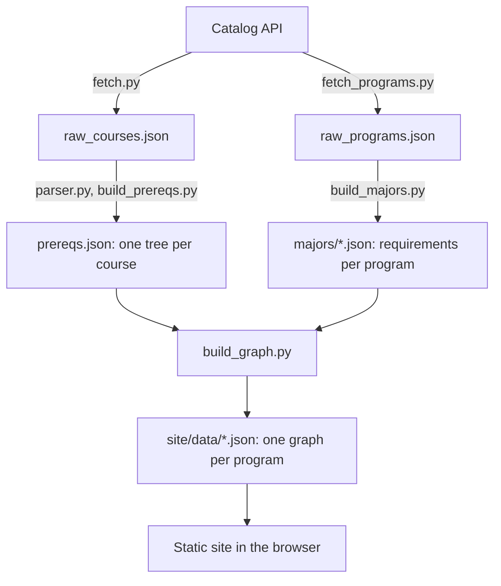

# Design: UCSB Prereq Planner

A static web app that turns the UCSB General Catalog into a prerequisite map for every major and minor (190 programs: 134 majors and 56 minors), plus a quarter-by-quarter planner with AP and college credit, grades and GPA.

It combines two ideas: a prerequisite map, like the Computer Engineering department's flowchart but for every program, and a four-year planner, like the Economics department's, with three of its gaps fixed. Courses go in with a click instead of a drag, credit a student already has counts toward prerequisites, and programs can be combined.

## Constraints

These shaped most of the decisions below.

- **No backend, no accounts.** The site is static files.
- **Student data stays on the student's device.** Plans live in the browser and in the share link. Transcripts are read in the browser and never uploaded.
- **No GOLD login.** The site never asks for a NetID or password. Uploading a transcript replaces it.
- **Honest about accuracy.** Every course links to its official catalog entry, and the site says it's unofficial.
- **Plain code.** Python and JavaScript with no framework.

## Architecture

There are two halves: a Python pipeline that runs once per catalog update, and a static site that runs entirely in the browser.

| Stage | Script | Output | What it does |
|---|---|---|---|
| Fetch | `fetch.py`, `fetch_programs.py` | `data/raw_*.json` | Downloads every course and program, about 40 requests |
| Parse | `parser.py`, `build_prereqs.py` | `data/prereqs.json` | Turns each prerequisite sentence into an AND/OR tree |
| Translate | `build_majors.py` | `data/majors/*.json` | Turns the catalog's requirement rules into five simple types |
| Build | `build_graph.py` | `site/data/*.json` | Connects trees and requirements into one graph per program |
| One-file copy | `build_single.py` | `site/ucsb-prereq-map.html` | Packs the whole site into one file that works offline |

The site is one page with one plain script per job:

| File | Job |
|---|---|
| `student.js` | The student's credit, plan and grades, saved in the browser |
| `search.js` | Program and course search, with nicknames |
| `app.js` | The map, the program picker, the address bar, switching views |
| `credit.js` | The AP and college-credit box |
| `planner.js` | The plan grid: placement, auto-fill, requirement progress |
| `grades.js` | Grades, GPA, goal-GPA targets |
| `transcript.js` | Reading a GOLD transcript in the browser |

## Key decisions

### Read the catalog's API instead of scraping pages

`fetch.py` sends the same requests catalog.ucsb.edu makes to its Coursedog backend. That returns exactly what the catalog shows, without cleaning up HTML, and eight requests cover every course. The cost is depending on an undocumented endpoint, and the catalog ID and date must be updated each year.

### A hand-written parser for prerequisite English

Prerequisites are free English, so their meaning has to be worked out. The parser makes three passes:

1. Protect phrases that contain "and" or "or" but aren't logic, such as "may be taken concurrently".
2. Split from the biggest separator to the smallest.
3. Attach minimum grades and "concurrent" flags by scope rules.

The result is a tree of four node types: `course`, `condition`, `and`, `or`. A rule-based parser is free to run, gives the same answer every time, and can be tested and explained rule by rule.

Unclear cases such as "ECE 10C and 10CL or 2C" are flagged, not guessed silently. Corrections live in `data/overrides.json`. CMPSC 16 is one: its sentence uses commas to mean both "and" and "or".

### Requirements: translate, don't parse

Major requirements already arrive as structured rules ("complete at least 6 of these courses"), so there was no need for a second parser. `build_majors.py` normalizes the catalog's eight rule types into five of our own: `course`, `text`, `all`, `choose`, `units`.

`completedAnyOf` and `completedAtLeastXOf` both become `choose` with an explicit `count`. `allOf` and `completedAllOf` both become `all`, because each item carries its own type. So `build_graph.py` and `planner.js` never need to know the catalog's format, and a format change touches one script.

The same step checks each course against the current course list, applies corrections from `data/program_overrides.json` for rules stated only in notes, and leaves out 66 retired programs.

### Do the heavy work at build time

The catalog changes rarely and is the same for everyone, so all the computation happens ahead of time. `build_graph.py` writes one ready-to-draw file per program, and the browser downloads only the program it needs: 130 KB for Computer Engineering, out of 5.5 MB of raw course data. This is what removes the need for a server. The cost is that the site is a snapshot until the pipeline is rerun.

Course search uses a separate index that refers to programs by position instead of by name, which shrank it from 650 KB to 233 KB.

### Prerequisites form a DAG

Connecting a program's trees gives a directed acyclic graph. `ColumnFinder` in `build_graph.py` computes each course's depth with a memoized depth-first search:

| Prerequisite | Column | Why |
|---|---|---|
| None | 0 | Can be taken right away |
| Needs B | column(B) + 1 | B takes a quarter |
| Needs B concurrently | column(B) | The same quarter is allowed |
| Needs B and C | max of the two | You wait for the later one |
| Needs B or C | min of the two | You take whichever comes first |

Memoization means each course is computed once, however many courses depend on it. A set of courses in progress detects loops. The graph is acyclic apart from lecture and lab pairs that each list the other as concurrent, such as CH ST 162 and 162L, which the search stops following.

### The map: steps, and arrows on demand

Courses sit in numbered steps, with each course's prerequisites in an earlier step. Arrows appear only when you point at or click a course: red for what it needs, blue for what it unlocks. A hundred courses with every arrow drawn is unreadable, so this follows the department flowchart, which hides arrows until hover. Steps come from the prerequisites, so all 190 programs lay themselves out.

An earlier version used the dagre layout library. The step layout replaced it.

`assignSteps()` also pushes each course below the prerequisites the map actually shows. Without that, MATH 4B landed beside MATH 4A in 12 programs, and a test caught it.

### One page, two views, no framework

Map and Plan are two views of one page, chosen by the address (`#economics-ba` or `#plan/economics-ba`). Both share the programs, credit, grades and loaded data, so nothing has to be kept in sync, and the one-file copy keeps working. The cost is global functions, and script order matters.

### Combining programs in the browser

`combine()` merges several programs' graphs when the page loads. Each course appears once with its strongest role (required beats "pick one", which beats elective) and lists every program it counts toward. Any combination works with no new data files.

### One rule for "done"

`isDone()` treats a course as done if it's ticked as taken, covered by AP or college credit, or has a passing grade in the plan. The map, the planner's checks and auto-fill all use it, so credit a student already has never gets flagged as a missing prerequisite.

The AP chart is typed into `data/ap_credit.json` from the catalog, and `build_credit.py` checks every course code in it against the current course list.

### Smart placement

Clicking a course runs `earliestSlot()`, which picks the first quarter where its prerequisites are done or planned earlier, it's usually offered, and the quarter stays under the unit cap (16 by default). ECON 1 goes to Fall, ECON 2 to Winter, ECON 10A to Spring.

Auto-fill orders courses with a topological sort (`prerequisiteOrder`), makes a safety pass (`repairOrder`), then spreads elective slots across the lightest quarters from year 3 on. The first version ordered by map column, which put ECE 10A before MATH 4B in Computer Engineering plus the Statistical Science minor, because the two programs' columns disagreed. The topological sort fixed that.

### Privacy without a backend

Plans are saved in localStorage and packed into the share link after the `#`, which browsers don't send to the server. Grades are left out of share links.

Transcripts are read in the browser, from a PDF through pdf.js or from pasted text, and shown in a review table before anything is applied. The student's name and perm number are never kept.

pdf.js 4.10.38 is downloaded with a fixed SHA-384 hash and run from a local copy, so a changed file is refused. Versions before 4.2.67 let a crafted PDF run code (CVE-2024-4367).

### The one-file copy

`build_single.py` puts the whole site and all 190 programs into one 8.7 MB HTML file that opens offline. Course details are stored once instead of once per program, which cuts 18 MB to under 9 MB.

## Testing and accuracy

### Parser accuracy

The parser is scored by `measure.py` on 450 test courses in three groups of 150. Each group has 100 random courses and 50 from math, stats, econ, ECE, CS and physics. The test answers were generated with AI, not written by a person.

| Group | How it was used | Exactly right |
|---|---|---|
| Tuning | Read while writing the rules | 98% |
| Held-out | First score 87% random, 80% major courses. Then used to fix bugs, so no longer clean | 97% / 96% |
| **Final** | **Labeled after the parser was frozen, scored once** | **90% (135 of 150)** |

Two parser bugs were fixed later, and rerunning the final group now gives 91%. That group had already been used, so 90% is the number to quote.

The gap between 98% and the first held-out score is the point of this setup: a score on examples used to build a parser says little about new text.

**How the answer key was checked.** The parser was graded against the answer key, and the answer key was spot-checked against the catalog. 30 randomly chosen answers from the final group (20 ordinary courses and 10 from the major departments) were checked by hand, deciding what each catalog sentence meant before seeing the answer. All 30 agreed. This is a sanity check, not proof: 30 is a small sample, many of the sentences were simple, and the same AI-assisted process produced both the parser and its test answers.

### Automated tests

- `tests/test_graph.py`: 30,466 checks over every program's graph, such as every prerequisite being in an earlier step and there being no loops.
- `tests/test_site.py`: 1,560 browser checks with Playwright, covering every program loading, phone sizes, search, the planner, reading a transcript from a generated PDF, and the one-file copy.

### Data checks

Ten random courses were checked by hand against their catalog pages, and all ten matched. Hand corrections live in `data/*overrides.json`, so they survive a rebuild.

## Known limits

- **When courses are offered** is the weakest data: known for 121 of 7,973 courses. The rest are assumed Fall, Winter and Spring, and marked with a "?".
- **Minimum grades** ("C or better") are shown but not enforced.
- **Difficulty-weighted GPA targets** aren't built. They need grade-distribution data whose terms of use allow it.
- **Transcript reading** depends on GOLD's layout. If it changes, the patterns need updating.
- **Catalog updates** are a manual rerun of the pipeline, and nothing yet lists what changed between runs.
- **Unofficial:** requirements change, so students should confirm with a department advisor.

## What's next

- A `compare_catalog.py` that re-downloads into a temporary folder and lists courses added or removed and prerequisites reworded before anything is overwritten.
- Better "when offered" data from past class schedules. UCSB's class-search API has it but needs an API key.
