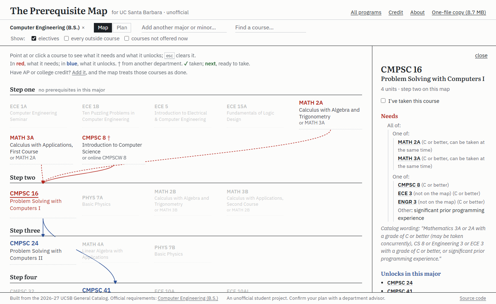

# UCSB Prereq Planner



Prerequisite maps for every UCSB major and minor, built from the official General Catalog, plus a quarter-by-quarter planner and a GPA calculator.

**Live at https://andrew-hanzhou-li.github.io/ucsb-prereq-map/**

## How it works

- **Fetch** the 2026-27 catalog from its Coursedog API, the same requests catalog.ucsb.edu makes (`pipeline/fetch.py`, `pipeline/fetch_programs.py`).
- **Parse** each course's prerequisite English into an AND/OR tree. On 150 hand-labeled courses, labeled after the parser was frozen and scored once, 91% (137 of 150) come out exactly right (`pipeline/parser.py`, scored by `pipeline/measure.py`).
- **Build** one graph per major or minor, with courses grouped into prerequisite steps (`pipeline/build_graph.py` writes `site/data/`).
- **Serve** a static site from `site/`, deployed to GitHub Pages by GitHub Actions on every push to `main`.

## Tech

Python (standard library only for the data pipeline; Playwright for the browser tests), vanilla JavaScript, pdf.js for reading transcripts in the browser, GitHub Pages.

## Design

How it's designed: [DESIGN.md](DESIGN.md) (coming soon).

## Run it locally

From the repo root (Windows):

```
py pipeline/build_prereqs.py
py pipeline/build_majors.py
py pipeline/build_graph.py
py pipeline/measure.py --quiet
py pipeline/build_credit.py
py pipeline/build_single.py
py tests/test_graph.py
```

`pipeline/fetch.py` and `pipeline/fetch_programs.py` download the catalog again (about 40 requests). Their output is already in `data/`, so you only need them for a new catalog year.

`build_single.py` makes `site/ucsb-prereq-map.html`, the whole site in one file that opens offline; the site's "One-file copy" link serves it.

To see the site, run `py -m http.server 8000 --directory site` and open http://localhost:8000. For the browser test, keep that running and in a second terminal run `py tests/test_site.py` (add the port, such as `py tests/test_site.py 8765`, if you used another one).

## Folders

| Folder | What's in it |
|---|---|
| `pipeline/` | Scripts that fetch the catalog and build the site's data |
| `data/` | Catalog downloads, parsed prerequisites, hand corrections (`*overrides.json`), and one requirements file per program in `data/majors/` |
| `tests/` | `test_graph.py` (data checks), `test_site.py` (browser checks), `test_labels.json` (hand-labeled parser answers) |
| `site/` | The website GitHub Pages publishes |
